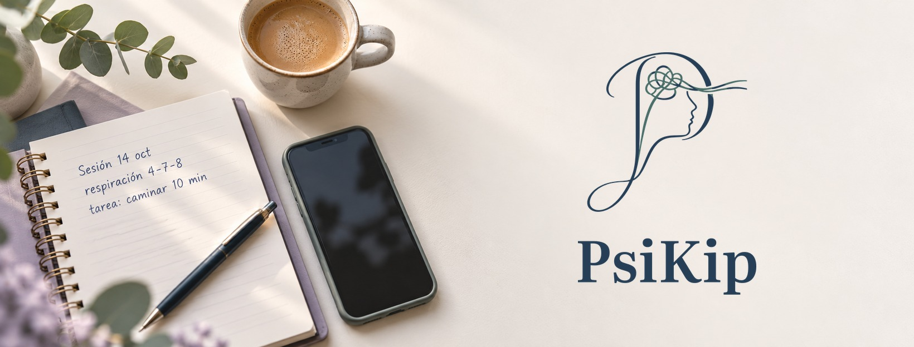
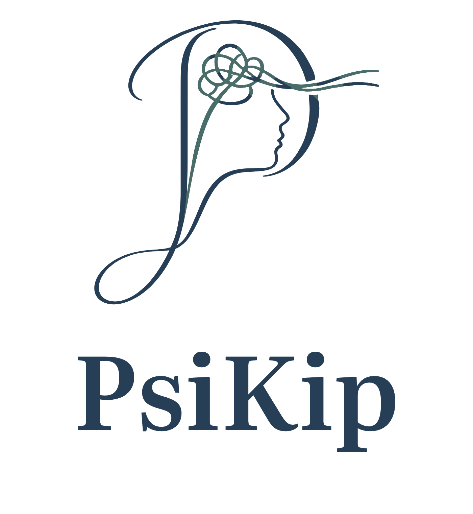

  

  <picture>
    <source media="(prefers-color-scheme: dark)" srcset="imagenes/psikip-logo-oscuro.png">
    
  </picture>

<h3 align="center">Asistente de redacción clínica para psicólogos y psiquiatras</h3>

<a href="https://psikip.com"><b>psikip.com</b></a> · México y Latinoamérica · En desarrollo

---

**Esta es la página de presentación de PsiKip.** El código fuente vive en un repositorio privado.

## ¿Qué es PsiKip?
Muchos psicólogos escriben sus notas de sesión a mano, en libreta, y después tienen que pasarlas en limpio al expediente. **PsiKip convierte ese trabajo en minutos:**

1. **Foto de la libreta**, **dictado** de 60 a 90 segundos o **texto** escrito.
2. PsiKip **ordena** el contenido en un borrador estructurado: una nota de evolución con formato tipo NOM-004, un informe o una carta de interconsulta.
3. El profesional **revisa y edita cada sección** antes de guardar.
4. La nota se guarda **en el expediente, en su propio dispositivo**, y se puede compartir en **PDF**.

> **La IA redacta; tú revisas y decides.** PsiKip no diagnostica: el juicio clínico es siempre del profesional.

## Principios
| | |
|---|---|
| **Fidelidad** | Lo que viene de la libreta se copia primero y se ordena después. Lo que no se lee se marca como `[ilegible]`; la IA no lo inventa. |
| **Privacidad** | Local primero: el expediente vive en el dispositivo del profesional, no en nuestros servidores. |
| **Criterio clínico** | Sin diagnóstico automático. Diseñado junto con psicólogas en práctica. |
| **Calma** | Una interfaz editorial y serena, hecha para terminar la nota y volver con los pacientes. |

## Tecnología
App móvil multiplataforma, para iOS y Android, con **Expo / React Native** y **TypeScript**. Los datos se guardan localmente en **SQLite** y la redacción usa un servicio de IA con reglas de fidelidad y control de costos.

## Estado
🟢 **Prototipo funcional en iPhone**, en pruebas internas con casos ficticios.
Validación clínica a cargo de una psicóloga con más de 20 años de práctica.

## Contacto
- Web: [psikip.com](https://psikip.com)
- Correo: [jorge@psikip.com](mailto:jorge@psikip.com)

---
© 2026 PsiKip. Todos los derechos reservados. La marca, el logotipo y el contenido de esta página no pueden usarse sin autorización.
